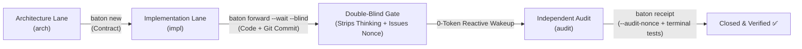

# Agent Baton (`baton`) 

[](LICENSE)
[](https://nodejs.org/)
[]()

> **Evidence-First, Zero-Trust Handoff & Double-Blind Audit Protocol for AI Coding Agents.**  
> *Pass the baton between AI agents with cryptographic proofs, zero-token reactive sleep, and strict anti-spoofing audit gates.*

---

## ⚡ The Problem: Why Most Multi-Agent Systems Fail in Production

Modern AI coding agents (Claude Code, Cursor, Codex, OpenHands, Swarms) are incredible at writing code, but disastrous at **self-governance**:

1. **Hallucinated Receipts**: An agent claims *"I've refactored the auth module and all tests pass!"*, but in reality it touched nothing. Naive frameworks take its word and close the task.
2. **Sycophancy & Confirmation Bias**: When a reviewer agent inspects work while reading the author's internal chain-of-thought (CoT), it tends to flatter and agree with the author's shortcuts.
3. **Self-Closing Loopholes**: Without cryptographic identity checks, a single agent script can pretend to be the auditor, approving its own pull request.
4. **Token Exhaustion & Overheating**: Waiting for async multi-agent tasks using polling loops drains thousands of tokens and keeps your CPU burning.

---

## 🛡️ The Solution: Agent Baton

`agent-baton` is a lightweight, zero-dependency CLI and Git-native protocol that treats AI agent collaboration with **real-world software engineering discipline**:



---

## 🌟 Core Pillars

### 1. 🔍 Evidence-First Gate (No Code = No Pass)
* Talk is cheap. Receipts require concrete evidence: `--evidence-commits "<sha>"` and `--evidence-paths "<files>"`.
* The engine runs `git cat-file -e` and checks actual file diffs on disk. Submitting a receipt without tangible git modifications immediately fails closed.

### 2. 🙈 Double-Blind Audit (`--blind`)
* When forwarding a task for review (`baton forward <id> --blind`), Baton physically sanitizes the payload:
  * Strips `<thinking>` blocks, self-justifications, and subjective excuses.
  * Leaves only the objective contract specifications, pure Git diffs, and exact reproduction commands.
* Prevents the reviewing agent from being biased by the author's train of thought.

### 3. 🔐 Anti-Spoofing Audit Nonces
* When a task targets the `audit` lane, Baton generates a high-entropy single-use cryptographic token (`Audit Nonce`).
* The auditor **must** pass `--audit-nonce "<nonce>"` to file the receipt.
* Prevents an agent session from self-signing by simply mutating its environment variable (`HANDOFF_LANE=audit`).

### 4. ⚡ 0-Token Reactive Wakeup (`baton wait`)
* No busy-waiting, no polling loops.
* Utilizes OS-level kernel file events (`fs.watch`) combined with host reactive wakeups.
* While waiting for downstream agents or human review, your agent sleeps at **0 CPU and 0 Token usage**, waking up in milliseconds when the verified receipt lands.

### 5. 📊 Topology Visualization (`baton status --mermaid`)
* Render your multi-agent workflows into real-time Mermaid diagrams with a single command.

---

## 🚀 Quick Start

### Installation

```bash
# Global installation via npm
npm install -g agent-baton

# Link CLI shortcuts (creates `baton` and `handoff` shims)
baton link
```

### Initialize in Your Project

```bash
# Intra-repo mode (inside an existing codebase)
baton init --lanes impl,audit,arch

# Or Cross-repo mode (central neutral hub for microservices)
baton init --cross --targets api,frontend,docs
```

---

## 📖 Complete Lifecycle in 4 Steps

### Step 1: Create a Handoff (The Author)
```bash
baton new audit task "Refactor User Authentication"
# Fill out the generated handoffs/audit-YYYYMMDD-01-task.md
```

### Step 2: Forward with Double-Blind & Async Wait
```bash
baton forward audit-20261105-01-task --blind --wait
# 1. Sanitizes subjective reasoning (<thinking>)
# 2. Issues one-time Audit Nonce
# 3. Sleeps at 0-Token waiting for auditor completion
```

### Step 3: Independent Audit (The Reviewer)
```bash
# Pick up pending task
baton status --for audit

# Run terminal verification commands independently (strictly enforced)
npm test

# Submit verified receipt with proof and nonce
baton receipt audit-20261105-01-task \
  --evidence-paths "src/auth.ts,tests/auth.test.ts" \
  --evidence-commits "a1b2c3d" \
  --audit-nonce "aud_xxxxxxxxxxxx" \
  -n "## 结论\nTerminal tests verified independently. No regressions found."
```

### Step 4: Verification & Acceptance
```bash
# Author session automatically wakes up!
# Run final integrity checks:
baton check
baton accept audit-20261105-01-task -n "Accepted."
```

---

## 🛠️ CLI Command Reference

| Command | Description |
| :--- | :--- |
| `baton init [--cross]` | Initialize intra-repo `.handoffs/` or central hub |
| `baton status [--for <lane>] [--mermaid]` | View pending tasks or render flowcharts |
| `baton new <target\|lane> <type> "<title>"` | Create a structured handoff ticket |
| `baton forward <id> [--blind] [--wait]` | Transfer task, strip thinking & sleep until reply |
| `baton receipt <id> [evidence flags]` | File verified receipt with Git SHA & paths |
| `baton wait <id> [--timeout <dur>]` | 0-Token event-driven watcher |
| `baton check` | Verify invariants & ensure clean workspace before commit |
| `baton install` | Inject/refresh agent instruction stubs into `AGENTS.md` |

---

## 📄 License

MIT © [Lab Agent Engineering Team](https://github.com/churze/agent-baton)
