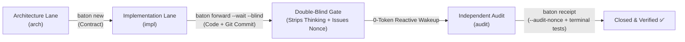

# Agent Baton (`baton`)

### Lossless, API-like Task Handoff Between Multi-Repo AI Agents

<div align="center">

[](LICENSE)
[](https://nodejs.org/)
[]()
[](CONTRIBUTING.md)

**🌐 English | [简体中文](docs/zh-CN/README.md)**

</div>

> **Stop copy-pasting prompts and fighting context rot.**  
> Penetrate repository boundaries with a single command, align strict collaboration contracts, enforce double-blind independent audits, and close the loop seamlessly via zero-token event-driven wakeups.  
> *(Evidence-First, Zero-Trust Handoff & Double-Blind Audit Protocol for AI Coding Agents)*

---

## ⚡ The Problem: Why Most Multi-Agent Systems Fail in Production

Modern AI coding agents (Claude Code, Cursor, Codex, OpenHands, Swarms) are incredible at writing code, but disastrous at **self-governance**:

| Industry Pitfall | Traditional Frameworks | Agent Baton Guarantee |
| :--- | :--- | :--- |
| **Hallucinated Receipts** | Agent says *"I've tested it"*; framework blindly accepts and closes task. | **Evidence-First Gate**: Requires tangible Git commits and paths verified via `git cat-file -e`. |
| **Sycophancy & Priming** | Reviewer agent reads author's train-of-thought and excuses missing tests. | **Double-Blind Audit (`--blind`)**: Automatically strips `<thinking>` and subjective excuses. |
| **Self-Closing Loopholes** | Single session switches role, approving its own PR. | **Audit Nonces & Separation of Powers**: Ephemeral cryptographic challenges block self-signing. |
| **Token Exhaustion** | Polling loops drain tokens and overheat CPU while waiting for async agents. | **0-Token Reactive Wakeup**: OS kernel events (`fs.watch`) put the agent to sleep at 0 CPU/Token cost. |

---

## 🛡️ Architecture & Workflow



---

## 🌟 Core Pillars

### 1. 🔍 Evidence-First Gate (No Code = No Pass)
* Talk is cheap. Receipts require concrete evidence: `--evidence-commits "<sha>"` and `--evidence-paths "<files>"`.
* The engine runs `git cat-file -e` and checks actual file diffs on disk. Submitting a receipt without tangible git modifications immediately fails closed.

### 2. 🙈 Double-Blind Audit (`--blind`)
* When forwarding a task for review (`baton forward <id> --blind`), Baton physically sanitizes the payload:
  * Strips `<thinking>` blocks, self-justifications, and subjective excuses.
  * Leaves only the objective contract specifications, pure Git diffs, and exact reproduction commands.
* Prevents the reviewing agent from being biased by the author's train of thought.

### 3. 🔐 Anti-Spoofing Audit Nonces
* When a task targets the `audit` lane, Baton generates a high-entropy single-use cryptographic token (`Audit Nonce`).
* The auditor **must** pass `--audit-nonce "<nonce>"` to file the receipt.
* Prevents an agent session from self-signing by simply mutating its environment variable (`HANDOFF_LANE=audit`).

### 4. ⚡ 0-Token Reactive Wakeup (`baton wait`)
* No busy-waiting, no polling loops.
* Utilizes OS-level kernel file events (`fs.watch`) combined with host reactive wakeups.
* While waiting for downstream agents or human review, your agent sleeps at **0 CPU and 0 Token usage**, waking up in milliseconds when the verified receipt lands.

### 5. 📊 Topology Visualization (`baton status --mermaid`)
* Render your multi-agent workflows into real-time Mermaid diagrams with a single command.

---

## 🚀 Quick Start

### Installation

```bash
# Global installation via npm
npm install -g agent-baton

# Link CLI shortcuts (creates `baton`, `agent-baton`, and `handoff` shims)
baton link
```

### Initialize in Your Project

```bash
# Intra-repo mode (inside an existing codebase; creates .handoffs/)
baton init --lanes impl,audit,arch

# Or Cross-repo mode (central neutral hub coordinating multiple microservices)
baton init --cross --targets api,frontend,docs
```

---

## 📖 Complete Lifecycle in 4 Steps

### Step 1: Create a Handoff (The Author)
```bash
baton new audit task "Refactor User Authentication"
# Fill out the generated handoffs/audit-YYYYMMDD-01-task.md
```

### Step 2: Forward with Double-Blind & Async Wait
```bash
baton forward audit-20261105-01-task --blind --wait
# 1. Sanitizes subjective reasoning (<thinking>)
# 2. Issues one-time Audit Nonce
# 3. Sleeps at 0-Token waiting for auditor completion
```

### Step 3: Independent Audit (The Reviewer)
```bash
# Pick up pending task
baton status --for audit

# Run terminal verification commands independently (strictly enforced)
npm test

# Submit verified receipt with proof and nonce
baton receipt audit-20261105-01-task \
  --evidence-paths "src/auth.ts,tests/auth.test.ts" \
  --evidence-commits "a1b2c3d" \
  --audit-nonce "aud_xxxxxxxxxxxx" \
  -n "## 结论\nTerminal tests verified independently. No regressions found."
```

### Step 4: Verification & Acceptance
```bash
# Author session automatically wakes up!
# Run final integrity checks:
baton check
baton accept audit-20261105-01-task -n "Accepted."
```

---

## 🔬 Under the Hood: How Baton Enforces Invariants

1. **Git SHA Verification**:
   When `--evidence-commits <sha>` is provided, Baton executes `git cat-file -e <sha>^{commit}` inside the repository. If the commit does not exist or was amended away, submission is rejected.
2. **Ephemeral Challenge Store**:
   Audit Nonces are kept in an isolated `.audit-challenges.json` protected by OS file permissions. Once verified during `baton receipt`, the challenge token is immediately wiped to prevent replay attacks.
3. **Adaptive Backoff & Event-Driven Engine**:
   While `fs.watch` captures instantaneous disk writes, Baton employs an exponential backoff fallback timer (2s $\to$ 4s $\to$ 8s $\to$ 15s) ensuring 100% notification delivery while preserving system battery life.

---

## 📚 Documentation & Specifications

- **[CLI Command Manual](COMMANDS.md)**: Exhaustive manual for all CLI flags, options, and exit codes.
- **[Receipt Specification](RESPONSE-TEMPLATE.md)**: Single source of truth for execution receipt schemas.
- **[Architecture & Design Whitepaper](DESIGN.md)**: Deep dive into multi-agent coordination theory and post-mortems.
- **[Contributing Guide](CONTRIBUTING.md)**: Setup, testing guidelines, and PR workflow.
- **[简体中文文档](docs/zh-CN/README.md)**: Complete Chinese documentation and guides.

---

## 📄 License

MIT © [Lab Agent Engineering Team](https://github.com/ChurzeXo/agent-baton)
