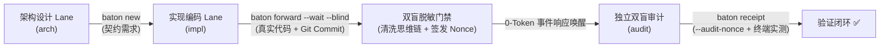

# Agent Baton (`baton`)

### 跨仓/同仓 Agent 间任务交割像调 API 一样无损直达

<div align="center">

**[English](../../README_OPENSOURCE.md) | 🌐 简体中文**

</div>

> **拒绝人肉传话与上下文衰减。**  
> 一条命令穿透仓库边界，接口与协作契约严密对齐，独立窗口双盲审计，事件驱动无感闭环。  
> *(面向 AI 编码智能体的实证驱动、零信任、双盲审计异步任务交割协议)*

---

## ⚡ 行业痛点：为什么多智能体协同难以在生产环境落地？

目前的编码 Agent（Claude Code, Cursor, Codex, OpenHands 等）单兵作战能力极强，但在**团队自律与互相审查**上漏洞百出：

| 行业通病 | 传统框架表现 | Agent Baton 核心防线 |
| :--- | :--- | :--- |
| **虚假回执与幻觉作弊** | Agent 嘴上宣称“我已改完并测试通过”，系统直接放行闭环。 | **实证主义硬门禁**：必须提供真实 Git Commit SHA 与修改路径，通过 `git cat-file -e` 物理核验。 |
| **顺从偏见与拍马屁** | 审查 Agent 读了开发 Agent 的思考过程与借口，下意识顺从附和。 | **双盲脱敏审计 (`--blind`)**：物理净化思维链（`<thinking>`）与自辩借口，只留客观契约与 Diff。 |
| **同一主体自导自演** | 同一个会话临时切换角色，自己给自己提的代码盖章合入。 | **审计防伪令牌 (Audit Nonce)**：派单时动态签发一次性随机令牌，回执必须核销 Nonce，杜绝自签。 |
| **轮询耗能与 Token 浪费** | 等待下游或人工回执时死循环轮询，耗尽 Token 且让电脑严重发热。 | **0-Token 响应式唤醒**：基于 OS 内核级事件驱动（`fs.watch`），挂起等待期间 0 CPU、0 Token 开销。 |

---

## 🛡️ 架构与生命周期



---

## 🚀 快速起步

### 全局安装

```bash
# 通过 npm 全局安装
npm install -g agent-baton

# 注册命令软链（生成 baton 与 handoff 快捷命令）
baton link
```

### 初始化项目

```bash
# 仓内模式（在既有代码库内创建 .handoffs/ 子 Hub）
baton init --lanes impl,audit,arch

# 跨仓模式（创建一个中立的中心调度 Hub，统筹协调多个微服务）
baton init --cross --targets api,frontend,docs
```

---

## 📖 四步标准工作流

### 第一步：创建交接单（发起方）
```bash
baton new audit task "重构用户认证鉴权模块"
# 编辑生成的 handoffs/audit-YYYYMMDD-01-task.md，填入客观判据与目标
```

### 第二步：转递并切入后台等待（实现方）
```bash
baton forward audit-20261105-01-task --blind --wait
# 1. 自动脱敏思维链与自辩内容
# 2. 签发专用 Audit Nonce 挑战令牌
# 3. 进程以 0-Token 待机挂起，等待回执自动唤醒
```

### 第三步：独立实测与回执提交（审计方）
```bash
# 查看待办
baton status --for audit

# 在终端独立执行验收判据中的命令（严禁仅静态读码）
npm test

# 提交带真凭实据与 Nonce 的回执
baton receipt audit-20261105-01-task \
  --evidence-paths "src/auth.ts,tests/auth.test.ts" \
  --evidence-commits "a1b2c3d" \
  --audit-nonce "aud_xxxxxxxxxxxx" \
  -n "## 结论\n已在终端独立执行全量测试，验证通过，无回归缺陷。"
```

### 第四步：验收闭环（发起方被自动唤醒）
```bash
# 发起方会话已被系统级 Reactive Wakeup 自动唤醒！
baton check
baton accept audit-20261105-01-task -n "已复核，闭环合入。"
```

---

## 📚 延伸文档

- **[CLI 命令手册 (英文)](../../COMMANDS.md)**：包含完整参数与状态机说明。
- **[回执规范单一真相源 (英文)](../../RESPONSE-TEMPLATE.md)**：回执正文结构模板。
- **[架构设计白皮书 (英文)](../../DESIGN.md)**：技术背景与六大不变量剖析。
- **[开源贡献指南 (英文)](../../CONTRIBUTING.md)**：参与贡献方式。

---

## 📄 开源许可

MIT © [Lab Agent Engineering Team](https://github.com/ChurzeXo/agent-baton)
